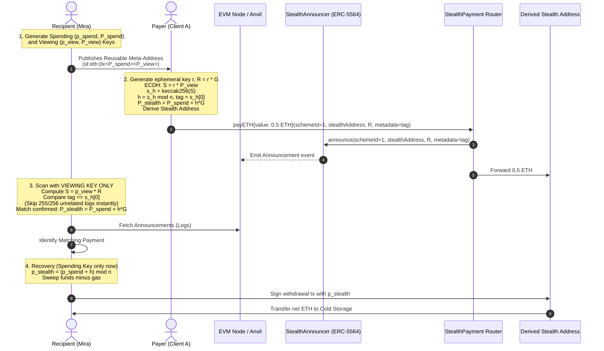

# StealthPay — ERC-5564 Stealth Payments on Ethereum

> **“Pay Me Somewhere New Every Time”**  
> A privacy-preserving Ethereum payment engine implementing **ERC-5564 Scheme 1 (secp256k1)**. A recipient publishes one reusable stealth meta-address; senders non-interactively derive a fresh, unique stealth address for every payment. Only the recipient can detect and spend the funds.

---

## Table of Contents

1. [System Overview & Architecture](#system-overview--architecture)
2. [ERC-5564 Scheme 1 Cryptography](#erc-5564-scheme-1-cryptography)
3. [Security Architecture & Threat Model](#security-architecture--threat-model)
4. [Smart Contracts](#smart-contracts)
5. [Repository Structure](#repository-structure)
6. [Getting Started](#getting-started)
7. [CLI Reference](#cli-reference)
8. [Automated Acceptance Checks](#automated-acceptance-checks)
9. [Full End-to-End Workflow Demonstration](#full-end-to-end-workflow-demonstration)

---

## System Overview & Architecture

Stealth payments enable unlinkable, non-interactive financial transfers on public blockchains. Traditional public addresses create public transaction graphs where every payment sent to an entity is permanently visible to all observers. StealthPay eliminates this linkage by ensuring every payment arrives at a single-use stealth address.



---

## ERC-5564 Scheme 1 Cryptography

StealthPay implements the formal specification of **ERC-5564 Scheme 1**:

### 1. Key Definitions
- **Secp256k1 Curve Parameters**: Base generator point $G$, group order $n = \text{0xFFFFFFFFFFFFFFFFFFFFFFFFFFFFFFFEBAAEDCE6AF48A03BBFD25E8CD0364141}$.
- **Recipient Spending Keypair**: $(p_{\text{spend}}, P_{\text{spend}})$, where $P_{\text{spend}} = p_{\text{spend}} \cdot G$. The private scalar is retained in cold storage and never exposed to the scanner.
- **Recipient Viewing Keypair**: $(p_{\text{view}}, P_{\text{view}})$, where $P_{\text{view}} = p_{\text{view}} \cdot G$. Used by the scanning agent to identify payments.
- **Stealth Meta-Address URI**:
  ```text
  st:eth:0x<spending_pubkey_compressed_33B><viewing_pubkey_compressed_33B>
  ```
  Total length: 66 raw bytes (132 hexadecimal characters after `0x`).

### 2. Payer-Side Derivation
1. Parse recipient's $P_{\text{spend}}$ and $P_{\text{view}}$.
2. Generate a cryptographically secure random ephemeral scalar $r \in [1, n-1]$ using CSPRNG (`crypto.getRandomValues`).
3. Compute ephemeral public key $R = r \cdot G$ (33 bytes compressed).
4. Perform ECDH: $S = r \cdot P_{\text{view}}$.
5. Compute hashed shared secret: $s_h = \text{keccak256}(S_{\text{compressed}})$.
6. Derive scalar: $h = s_h \pmod n$.
7. Extract 1-byte view tag: $v = s_h[0]$.
8. Derive stealth public point:
   $$P_{\text{stealth}} = P_{\text{spend}} + h \cdot G$$
9. Derive Ethereum stealth address:
   $$\text{Address} = \text{last20bytes}(\text{keccak256}(\text{uncompressed } P_{\text{stealth}} \setminus \{0\text{x}04\}))$$

### 3. Recipient-Side View-Tag-First Scanning
The scanner receives **only** $(p_{\text{view}}, P_{\text{spend}})$ and public on-chain announcements:
1. Validate scheme identifier ($\text{schemeId} == 1$).
2. Validate ephemeral public key point $R$.
3. Compute ECDH shared secret: $S = p_{\text{view}} \cdot R$.
4. Compute $s_h = \text{keccak256}(S_{\text{compressed}})$.
5. Compare view tag: $s_h[0] == \text{announced\_tag}$.
   - **Fast Rejection**: If tags mismatch, **abort immediately**. No point additions or address derivations are executed (~99.6% skip rate for irrelevant announcements).
6. On tag match:
   - Compute $h = s_h \pmod n$.
   - Compute $P_{\text{stealth}} = P_{\text{spend}} + h \cdot G$.
   - Compute $\text{DerivedAddress} = \text{publicKeyToAddress}(P_{\text{stealth}})$.
   - If $\text{DerivedAddress} == \text{announcement.stealthAddress}$, record incoming payment.

### 4. Spending Authority & Private Key Recovery
When the recipient chooses to withdraw funds, the spending private key $p_{\text{spend}}$ is introduced:
1. Recompute $S = p_{\text{view}} \cdot R$ and $s_h = \text{keccak256}(S_{\text{compressed}})$.
2. Compute $h = s_h \pmod n$.
3. Recover the stealth private key scalar:
   $$p_{\text{stealth}} = (p_{\text{spend}} + h) \pmod n$$
4. **Verification**: Confirm that $p_{\text{stealth}} \cdot G$ produces the expected stealth address.
5. Sign transaction transferring the entire balance minus native transfer gas ($21{,}000 \times \text{gasPrice}$) to a destination address.

---

## Security Architecture & Threat Model

Stealth payments solve address reuse and on-chain recipient identification. However, privacy requires clear understanding of observer capabilities:

| Observer | What They Can Learn | What Remains Private |
| :--- | :--- | :--- |
| **Payer** | Knows the payment amount, stealth address, and that it went to recipient's meta-address. | Cannot spend the funds; does not know when or where the recipient will eventually sweep or spend them. |
| **Recipient** | Discovers all incoming payments, spending keys, and full transaction history. | Retains sole spending authority and private identity. |
| **Public Observer** | Sees an announcement event and ETH transferred to a fresh address. Cannot link the stealth address to the recipient's meta-address or identity. | **Cannot link the payment to the recipient's identity.** Cannot determine if two distinct stealth addresses belong to the same recipient. |
| **RPC Provider** | Observes IP addresses, query timestamps, and queried block ranges or address balances. | Cannot compute shared secrets or spend funds. |

### Critical Privacy Caveats:
1. **Network Layer / RPC Privacy**: If a recipient queries a remote RPC provider for a single specific stealth address balance, the RPC provider can infer interest in that address. **Best practice**: Use block-range log filtering and local nodes (or private RPCs) rather than polling individual stealth addresses.
2. **Subsequent Spending & Graph Analysis**: If a recipient withdraws funds from multiple stealth addresses into a single centralized exchange address or public account simultaneously, a chain analysis heuristic can cluster those stealth addresses. To preserve privacy upon withdrawal, use independent gas relays, separate destination accounts, or decentralized privacy pools.

---

## Smart Contracts

The repository includes standard, audited-pattern Solidity contracts (`0.8.24`):

### 1. `StealthAnnouncer.sol`
Implements the canonical `IERC5564Announcer` interface. Emits public announcements for incoming stealth payments:
```solidity
event Announcement(
    uint256 indexed schemeId,
    address indexed stealthAddress,
    address indexed caller,
    bytes ephemeralPubKey,
    bytes metadata
);
```

### 2. `StealthPayment.sol`
A payment router that forwards native ETH to the stealth address and invokes `StealthAnnouncer.announce` atomically in a single transaction, preventing payment-announcement desynchronization. Follows strict Checks-Effects-Interactions and includes custom event logging with payment amounts.

---

## Repository Structure

```text
stealthpay-one-time-addresses/
├── contracts/                  # Solidity smart contracts
│   ├── IERC5564Announcer.sol  # Canonical ERC-5564 Announcer interface
│   ├── StealthAnnouncer.sol   # Reference announcer contract
│   └── StealthPayment.sol     # Atomic payment and announcement router
├── src/                        # Core TypeScript implementation
│   ├── crypto/                # Elliptic-curve & cryptographic primitives
│   │   ├── constants.ts       # Secp256k1 & ERC-5564 Scheme 1 parameters
│   │   ├── types.ts           # Types & interfaces (strict key separation)
│   │   ├── utils.ts           # CSPRNG, scalar/point validation, address derivation
│   │   ├── keys.ts            # Keypair generation & separation guards
│   │   ├── metaAddress.ts     # ERC-5564 URI encoding & validation
│   │   ├── payer.ts           # Ephemeral key & stealth address derivation
│   │   ├── scanner.ts         # Recipient scanning & view-tag filtering
│   │   └── recovery.ts        # Modulo n private key recovery
│   ├── chain/                 # EVM blockchain interactions (viem)
│   │   ├── abis.ts            # Typed contract ABIs
│   │   ├── config.ts          # Anvil chain configuration & persistence
│   │   ├── client.ts          # Public & Wallet client factories
│   │   ├── deploy.ts          # Contract deployment automation
│   │   ├── announcer.ts       # Block-chunked announcement querying
│   │   ├── pay.ts             # On-chain payment execution
│   │   └── withdraw.ts        # Balance sweep with gas deduction
│   └── cli/                   # User-facing CLI tool
│       ├── keystore.ts        # Protected local key store
│       └── index.ts           # Commander CLI commands
├── test/                       # Test suites
│   ├── foundry/               # Foundry Solidity test suite (10 tests)
│   │   └── StealthContracts.t.sol
│   ├── crypto.test.ts         # Acceptance tests 1-7 & crypto edge cases (8 tests)
│   ├── secrets.test.ts        # Acceptance test 9: Secret scanner checks (4 tests)
│   └── e2e.test.ts            # Acceptance test 8 & end-to-end on-chain tests (4 tests)
├── scripts/
│   ├── deploy.ts              # Local deployment runner
│   ├── demo.ts                # 8-step interactive demonstration script
│   └── check-secrets.ts       # Repository secret scanning script
├── bin/
│   └── stealthpay.js          # Executable CLI binary
├── foundry.toml               # Foundry configuration
├── tsconfig.json              # TypeScript strict configuration
├── vitest.config.ts           # Vitest configuration
├── package.json               # Dependencies & scripts
├── .env.example               # Environment template
└── .gitignore                 # Secret-protection ignore rules
```

---

## Getting Started

### Prerequisites
- **Node.js**: v18+ (tested on Node v24)
- **Foundry**: `forge` and `anvil` installed

### Installation

```bash
# Clone and enter directory
cd stealthpay-one-time-addresses

# Install dependencies
npm install

# Compile contracts with Forge
npm run compile:forge

# Build TypeScript codebase
npm run build
```

### Start Local Anvil Blockchain

In a separate terminal window:
```bash
anvil --port 8545
```

### Deploy Contracts Locally

```bash
npm run deploy:local
```
This deploys `StealthAnnouncer` and `StealthPayment` to Anvil and persists addresses to `deployments.json`.

---

## CLI Reference

Run via `node ./bin/stealthpay.js` or `npm run cli -- <command>`.

### 1. Generate Stealth Keys
Generates spending and viewing keypairs and saves them securely in `.stealthpay/keys.json`:
```bash
node ./bin/stealthpay.js keys create
```

### 2. View Reusable Meta-Address
Prints the recipient's ERC-5564 URI:
```bash
node ./bin/stealthpay.js meta-address
# Output: st:eth:0x<spending_pubkey><viewing_pubkey>
```

### 3. Send a Stealth Payment
Payer derives a one-time stealth address and sends ETH with an announcement:
```bash
node ./bin/stealthpay.js pay --meta-address st:eth:0x... --amount 0.50
```

### 4. Scan Announcements
Scans on-chain events using **only** viewing private key and spending public key:
```bash
node ./bin/stealthpay.js scan --from-block 0
```

### 5. Check Balances
Inspects balance across scanned stealth addresses:
```bash
node ./bin/stealthpay.js balance
```

### 6. Recover and Withdraw
Sweeps net funds from a detected stealth address to a cold storage address:
```bash
node ./bin/stealthpay.js withdraw --to 0x70997970C51812dc3A010C7d01b50e0d17dc79C8 --all
```

---

## Automated Acceptance Checks

The test suite validates all 9 scored acceptance checks across Foundry and Vitest:

| # | Acceptance Check | Test File | Status |
| :--- | :--- | :--- | :--- |
| **1** | **Private-key separation**: Scanner functions with viewing private key + spending public key only; spending private key is never loaded. | `test/crypto.test.ts` | **PASSED** |
| **2** | **Fresh ephemeral keys**: Each payment call generates a new cryptographically secure random scalar. | `test/crypto.test.ts` | **PASSED** |
| **3** | **Correct stealth derivation**: Derives stealth public key $P_{\text{stealth}} = P_{\text{spend}} + h \cdot G$ and matching Ethereum address. | `test/crypto.test.ts` | **PASSED** |
| **4** | **Correct private-key recovery**: Scalar $(p_{\text{spend}} + h) \pmod n$ matches the derived stealth address. | `test/crypto.test.ts` | **PASSED** |
| **5** | **View-tag-first scanning**: Mismatched view tag aborts address derivation immediately. | `test/crypto.test.ts` | **PASSED** |
| **6** | **Unrelated announcement ignored**: Announcements for another recipient are skipped. | `test/crypto.test.ts` | **PASSED** |
| **7** | **Distinct payment addresses**: Two payments to one meta-address produce distinct addresses. | `test/crypto.test.ts` | **PASSED** |
| **8** | **On-chain ephemeral-key publication**: Payment emits announcement containing ephemeral public key and view tag. | `test/e2e.test.ts` | **PASSED** |
| **9** | **No committed secrets**: Automated scanner checks for accidental keys, tokens, or uncommitted files. | `test/secrets.test.ts` | **PASSED** |

### Running Tests

```bash
# Run Foundry Solidity tests (10 contract tests)
npm run test:forge

# Run all TypeScript unit and integration tests (16 tests)
npm test

# Run repository secret check
npm run check:secrets
```

---

## Full End-to-End Workflow Demonstration

Run the automated interactive 8-step demonstration:
```bash
npm run demo
```

This executes:
1. **Mira generates keys** and publishes one reusable meta-address.
2. **Client A sends 0.50 ETH** to her meta-address.
3. **Client B sends 0.75 ETH** to her meta-address.
4. **Distinct addresses verified**: Payments land at separate, unlinkable addresses.
5. **Mira scans announcements** using **only** viewing private key and spending public key.
6. **Mira identifies both payments** while ignoring unrelated traffic.
7. **Mira recovers spending keys only at withdrawal** and sweeps both balances to cold storage.
8. **Unrelated announcements ignored**: Proves zero false positives.
