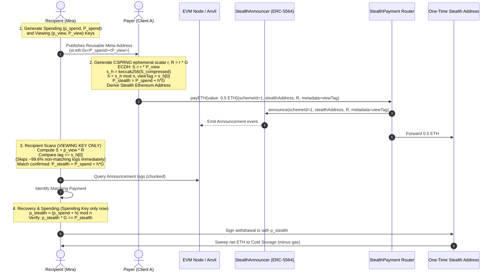

# StealthPay — ERC-5564 Stealth Payments on Ethereum

> **“Pay Me Somewhere New Every Time”**  
> A privacy-preserving Ethereum payment engine implementing **ERC-5564 Scheme 1 (secp256k1 with view tags)**. A recipient publishes one reusable stealth meta-address; senders non-interactively derive a fresh, unique stealth address for every payment. Only the recipient can detect and spend the funds.

[](https://github.com/nikitabiradar231/payveil_d10_p1/actions/workflows/ci.yml)
[](LICENSE)
[](https://eips.ethereum.org/EIPS/eip-5564)

---

## Table of Contents

1. [Problem Statement & Solution](#problem-statement--solution)
2. [Key Features](#key-features)
3. [System Architecture & Workflow](#system-architecture--workflow)
4. [ERC-5564 Scheme 1 Cryptography](#erc-5564-scheme-1-cryptography)
5. [Security Architecture & Threat Model](#security-architecture--threat-model)
6. [Smart Contracts](#smart-contracts)
7. [Repository Structure](#repository-structure)
8. [Getting Started & Local Deployment](#getting-started--local-deployment)
9. [CLI Reference & Examples](#cli-reference--examples)
10. [Automated Acceptance Checks Matrix](#automated-acceptance-checks-matrix)
11. [Full End-to-End Workflow Demonstration](#full-end-to-end-workflow-demonstration)
12. [Security Audit Report](#security-audit-report)

---

## Problem Statement & Solution

### The Problem
On public blockchains like Ethereum, address reuse creates permanent public transaction graphs. When an individual, merchant, or DAO receives multiple payments to a single public address, external observers and surveillance firms can effortlessly track transaction histories, aggregate account balances, and map out social networks.

### The StealthPay Solution
StealthPay implements the finalized **ERC-5564 (Stealth Addresses)** standard under **Scheme 1 (secp256k1)**:
- **One Reusable Meta-Address**: Recipient shares a single static identifier ($P_{\text{spend}}, P_{\text{view}}$).
- **Zero Recipient Interaction**: Senders derive single-use destination addresses non-interactively.
- **Fast Scanning (~99.6% Rejection Rate)**: 1-byte view tags allow recipients to skip irrelevant announcements without expensive point additions or address derivations.
- **Strict Key Separation**: Scanning is performed with the viewing private key only; spending private keys are loaded strictly at withdrawal time.
- **On-Chain Privacy**: Observers see funds moving to fresh addresses with no cryptographic link to the recipient's meta-address or identity.

---

## Key Features

- **100% Spec-Compliant ERC-5564 Scheme 1**: Standard `st:eth:0x...` URI parsing (supports both dual-key $2n$ and single-key $n$ meta-addresses).
- **Atomic Router Contract (`StealthPayment.sol`)**: Guarantees payment forwarding and announcement publication succeed or revert atomically, with reentrancy protection.
- **Gas-Optimized Sweeper (`withdraw`)**: Calculates exact native transfer gas costs and dynamically estimates gas for contract destinations.
- **View-Tag-First Fast Filter**: Rejects non-matching logs with a single byte check before executing elliptic curve operations.
- **Zero Committed Secrets**: Continuous secret-scanning check and strict `.gitignore` rules prevent key leakage.

---

## System Architecture & Workflow



---

## ERC-5564 Scheme 1 Cryptography

StealthPay implements the formal specification of **ERC-5564 Scheme 1** using `@noble/curves/secp256k1`:

### 1. Mathematical Definitions
- **Curve Order**: $n = \text{0xFFFFFFFFFFFFFFFFFFFFFFFFFFFFFFFEBAAEDCE6AF48A03BBFD25E8CD0364141}$.
- **Recipient Keys**:
  - Spending Keypair: $(p_{\text{spend}}, P_{\text{spend}})$ where $P_{\text{spend}} = p_{\text{spend}} \cdot G$.
  - Viewing Keypair: $(p_{\text{view}}, P_{\text{view}})$ where $P_{\text{view}} = p_{\text{view}} \cdot G$.
- **Stealth Meta-Address URI**:
  ```text
  st:eth:0x<spending_pubkey_compressed_33B><viewing_pubkey_compressed_33B>
  ```
  Also supports single-key format `st:eth:0x<pubkey_33B>` where spending = viewing.

### 2. Payer Derivation Equations
1. Parse $P_{\text{spend}}$ and $P_{\text{view}}$.
2. Generate $r \in_{\text{CSPRNG}} [1, n-1]$.
3. Compute $R = r \cdot G$ (33 bytes compressed).
4. Compute ECDH: $S = r \cdot P_{\text{view}}$.
5. Compute hashed secret: $s_h = \text{keccak256}(S_{\text{compressed}})$.
6. Derive scalar: $h = s_h \pmod n$.
7. Extract view tag: $v = s_h[0]$.
8. Derive stealth public key: $P_{\text{stealth}} = P_{\text{spend}} + h \cdot G$.
9. Derive Ethereum address: $\text{last20}(\text{keccak256}(\text{uncompressed } P_{\text{stealth}} \setminus \{0\text{x}04\}))$.

### 3. Recipient Fast Scanning
1. Validate $\text{schemeId} == 1$ and ephemeral point $R \neq \mathcal{O}$.
2. Compute $S = p_{\text{view}} \cdot R$.
3. Check view tag: $s_h[0] == \text{announced\_tag}$.
   - **Fast abort**: If tags differ, discard log immediately without computing point addition or address derivation.
4. On tag match: Compute $P_{\text{stealth}} = P_{\text{spend}} + h \cdot G$ and check derived address matches announced stealth address.

### 4. Key Recovery & Sweep
1. Recompute $h = \text{keccak256}(p_{\text{view}} \cdot R) \pmod n$.
2. Recover stealth private scalar:
   $$p_{\text{stealth}} = (p_{\text{spend}} + h) \pmod n$$
3. Validate: Confirm $p_{\text{stealth}} \cdot G == P_{\text{stealth}}$.
4. Sweep funds deducting exact native gas costs.

---

## Security Architecture & Threat Model

| Observer | What They Can Learn | What Remains Confidential |
| :--- | :--- | :--- |
| **Payer** | Stealth address, payment amount, recipient meta-address. | Cannot recover spending key; cannot determine recipient's withdrawal destination. |
| **Recipient** | Discovers incoming payments, computes spending key. | Spending key remains secret. |
| **Public Observer** | Announcement events and funds arriving at fresh address. | Cannot link stealth address to recipient's meta-address or identity. |
| **RPC Provider** | IP address, timestamp, block-range log queries. | Cannot derive shared secrets or access funds. |

### Privacy Best Practices:
1. **Withdrawal Unlinking**: Never sweep multiple stealth addresses into a single centralized exchange deposit address in the same transaction or block. Use independent destinations or privacy pools.
2. **RPC Query Privacy**: Query logs across broad block ranges rather than querying individual stealth addresses directly.

---

## Smart Contracts

- **[`IERC5564Announcer.sol`](contracts/IERC5564Announcer.sol)**: Official ERC-5564 specification interface.
- **[`StealthAnnouncer.sol`](contracts/StealthAnnouncer.sol)**: Singleton announcer emitting standard `Announcement` events.
- **[`StealthPayment.sol`](contracts/StealthPayment.sol)**: Atomic payment forwarder and announcer with reentrancy protection.

---

## Repository Structure

```text
stealthpay-one-time-addresses/
├── contracts/                  # Solidity contracts (0.8.24)
│   ├── IERC5564Announcer.sol  # Canonical ERC-5564 interface
│   ├── StealthAnnouncer.sol   # Announcer implementation
│   └── StealthPayment.sol     # Atomic payment router
├── src/
│   ├── crypto/                # secp256k1 & ERC-5564 crypto
│   │   ├── constants.ts       # Scheme 1 & curve constants
│   │   ├── types.ts           # Types & strict key separation
│   │   ├── utils.ts           # CSPRNG, point/scalar validation
│   │   ├── keys.ts            # Keypair generation & guards
│   │   ├── metaAddress.ts     # ERC-5564 URI encoding & parser
│   │   ├── payer.ts           # Payer address derivation
│   │   ├── scanner.ts         # Fast view-tag-first scanner
│   │   ├── recovery.ts        # Modulo n key recovery
│   │   ├── metadata.ts        # 57-byte ETH metadata encoding/decoding
│   │   └── standard.ts        # Standard ERC-5564 checkStealthAddress & computeStealthKey
│   ├── chain/                 # Blockchain integration (viem)
│   │   ├── abis.ts            # Typed contract ABIs
│   │   ├── client.ts          # Viem client factories
│   │   ├── deploy.ts          # Automated deployment
│   │   ├── pay.ts             # On-chain payment execution
│   │   └── withdraw.ts        # Balance sweep with gas deduction
│   └── cli/                   # User CLI
├── test/
│   ├── foundry/               # Foundry tests (11 tests)
│   ├── crypto.test.ts         # Acceptance tests 1-7 (11 tests)
│   ├── interop.test.ts        # Independent ERC-5564 interop tests (8 tests)
│   ├── e2e.test.ts            # Acceptance test 8 & on-chain flow (4 tests)
│   ├── secrets.test.ts        # Acceptance test 9: secret scan (4 tests)
│   └── cli.test.ts            # CLI command tests (2 tests)
├── scripts/
│   ├── deploy.ts              # Local deploy script
│   ├── demo.ts                # 8-step interactive demo
│   └── check-secrets.ts       # Secret leak scanner
├── .github/workflows/ci.yml   # Continuous integration
├── AUDIT_REPORT.md            # Comprehensive security audit
├── SUBMISSION.md              # Buildathon submission summary
└── README.md
```

---

## Getting Started & Local Deployment

### Prerequisites
- **Node.js**: v18+ (tested on Node v20/v24)
- **Foundry**: `forge` and `anvil`

### 1. Install & Build
```bash
npm install
npm run compile:forge
npm run build
```

### 2. Start Anvil
```bash
anvil --port 8545
```

### 3. Deploy Contracts Locally
```bash
npm run deploy:local
```

---

## CLI Reference & Examples

Run commands using `node ./bin/stealthpay.js <command>`:

```bash
# 1. Generate keys
node ./bin/stealthpay.js keys create

# 2. View reusable stealth meta-address
node ./bin/stealthpay.js meta-address

# 3. Pay to a stealth meta-address
node ./bin/stealthpay.js pay --meta-address st:eth:0x... --amount 0.50

# 4. Scan blockchain using only viewing private key
node ./bin/stealthpay.js scan --from-block 0

# 5. Check balances across discovered stealth addresses
node ./bin/stealthpay.js balance

# 6. Recover spending key and withdraw net funds
node ./bin/stealthpay.js withdraw --to 0x70997970C51812dc3A010C7d01b50e0d17dc79C8 --all
```

---

## Automated Acceptance Checks Matrix

| # | Acceptance Criterion | Test Location | Result |
| :--- | :--- | :--- | :--- |
| **1** | **Private-key separation**: Scanner functions with viewing private key + spending public key only; spending key never loaded. | `test/crypto.test.ts` (Test 1) | **PASS** |
| **2** | **Fresh ephemeral keys**: Each payment call generates a new cryptographically secure random scalar. | `test/crypto.test.ts` (Test 2) | **PASS** |
| **3** | **Correct stealth derivation**: Derives stealth public key $P_{\text{stealth}} = P_{\text{spend}} + h \cdot G$ and matching Ethereum address. | `test/crypto.test.ts` (Test 3) | **PASS** |
| **4** | **Correct private-key recovery**: Scalar $(p_{\text{spend}} + h) \pmod n$ matches the derived stealth address. | `test/crypto.test.ts` (Test 4, 4b) | **PASS** |
| **5** | **View-tag-first scanning**: Mismatched view tag aborts address derivation immediately. | `test/crypto.test.ts` (Test 5) | **PASS** |
| **6** | **Unrelated announcement ignored**: Announcements for another recipient are skipped. | `test/crypto.test.ts` (Test 6) | **PASS** |
| **7** | **Distinct payment addresses**: Two payments to one meta-address produce distinct addresses. | `test/crypto.test.ts` (Test 7) | **PASS** |
| **8** | **On-chain ephemeral-key publication**: Payment emits announcement containing ephemeral public key and view tag. | `test/e2e.test.ts` (Test 8) | **PASS** |
| **9** | **No committed secrets**: Automated scanner checks for accidental keys, tokens, or uncommitted files. | `test/secrets.test.ts` (All tests) | **PASS** |

### Execution Commands:
```bash
# Run Foundry contract suite (11 tests)
npm run test:forge

# Run TypeScript unit, interop and integration test suite (29 tests across 5 suites)
npm test

# Run repository secret scanner
npm run check:secrets
```

---

## Full End-to-End Workflow Demonstration

Run the automated live demonstration:
```bash
npm run demo
```

### Actual Output from Verified Run:
```text
================================================================
  StealthPay — ERC-5564 Full Interactive Demonstration
================================================================

STEP 1: Mira generates separate spending and viewing keypairs...
  Mira Spending Public Key: 0x03d509709754fede6ed1be2ce415d37c5921a0bb60b1ac11d5fd967b0230b09aea
  Mira Viewing Public Key:  0x02993086407519f8b3a7329d58aa4f389b601ccfaed480b22b3b97e25e9a794bba
  Mira Reusable Meta-Addr:  st:eth:0x03d509709754fede6ed1be2ce415d37c5921a0bb60b1ac11d5fd967b0230b09aea02993086407519f8b3a7329d58aa4f389b601ccfaed480b22b3b97e25e9a794bba

STEP 2: Client A sends 0.50 ETH to Mira's stealth meta-address...
  Payment A derived Stealth Address: 0x1B23FE7d5381DF28cF55F40A7F508d66556B2E7d
  Ephemeral Public Key (R):         0x02d7f1e8a603c4f2db8e1d4e5714f0287cc231acbe16932e9cdd873d8ae3bd303b
  Published View Tag:               0xc6
  Tx Hash:                          0x840fb5352bd285068fd76d1fce36a352486da4d9bc056f6669617bdb55bd3aa0

STEP 3: Client B sends 0.75 ETH to Mira's stealth meta-address...
  Payment B derived Stealth Address: 0x13A002E719f083186F8C5b2E7D86F7F0e5D425fa
  Ephemeral Public Key (R):         0x0288b7d612bbce9cab3b3cfe2b764258d55f1002c3970941763331825f83a3c8f6
  Published View Tag:               0x60
  Tx Hash:                          0x4b5a2552d3f938a9799470bf37cb1f979a4e802720a38f02e1a7de5515eca887

--- Unrelated noise: Client C sends 0.10 ETH to Bob's meta-address ---
  Payment to Bob Stealth Address:   0x3dB959D7db37b20aBC214fD071deC59f62b73AAc

STEP 4: Verifying payment address uniqueness...
  ✅ Pay A and Pay B derived completely distinct stealth addresses!

STEP 5: Mira scans announcements using ONLY viewing.privateKey & spending.publicKey...
  🔒 Strict security check: spending private key is NOT passed to scanner.

STEP 6: Mira scans and identifies matching payments:
  Total announcements checked: 2
  View-tag skips (fast path):  0
  Matching payments detected:  2
  Payment #1: Address: 0x1B23FE7d5381DF28cF55F40A7F508d66556B2E7d | Balance: 0.5 ETH
  Payment #2: Address: 0x13A002E719f083186F8C5b2E7D86F7F0e5D425fa | Balance: 0.75 ETH

STEP 7: Mira recovers spending keys only at withdrawal time and sweeps funds...
  Sweeping Payment #1 (0x1B23FE7d5381DF28cF55F40A7F508d66556B2E7d)...
    ✅ Transferred 0.49997731308176 ETH to cold storage.
    Tx Hash: 0xbad7cfc3e615ef8b96262d1c55f0f2d86d96aae97109f8851523d7062032bb19
  Sweeping Payment #2 (0x13A002E719f083186F8C5b2E7D86F7F0e5D425fa)...
    ✅ Transferred 0.749977523651322 ETH to cold storage.
    Tx Hash: 0xf04dbcc2e064c1f6fe83d461b4135e0c14780c3c3dbb9f8b33f547ac5476ccad
  Cold Storage Balance Increase: 1.249954836733082 ETH

STEP 8: Verifying unrelated announcements to Bob were ignored by Mira...
  ✅ Confirmed: Bob's payment was completely ignored by Mira.

================================================================
  🎉 DEMONSTRATION COMPLETE: ALL 8 STEPS VERIFIED SUCCESSFULLY!
================================================================
```

---

## Security Audit Report

Detailed technical findings, specification checks, and edge-case remediations are documented in **[`AUDIT_REPORT.md`](AUDIT_REPORT.md)**.
